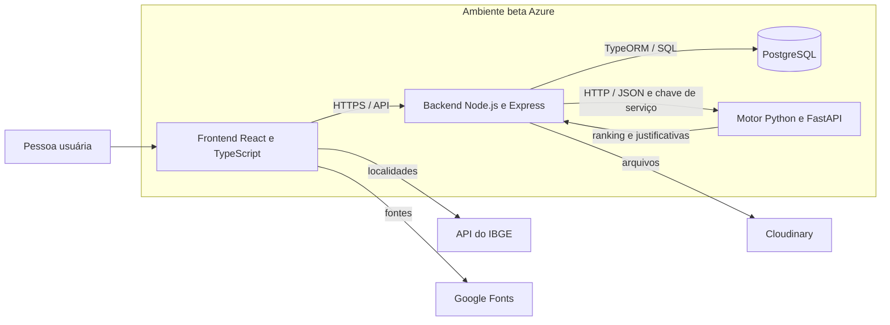

# Juntaí! Motor de matchmaking

**Juntaí!** é uma plataforma acadêmica que aproxima startups, investidores anjo e mentores do ecossistema de inovação do Nordeste. Este repositório contém o serviço de recomendação que recebe projeções de perfis do backend e devolve listas ordenadas para apoiar a descoberta de oportunidades.

O projeto integra o Projeto Integrador do 5º período de Análise e Desenvolvimento de Sistemas da Faculdade Senac Pernambuco. A pontuação não garante interesse, contato, investimento ou retorno financeiro; a decisão continua com os participantes.

**Demonstração beta na Azure:** [acessar a plataforma](https://delightful-beach-0c45f1a10.4.azurestaticapps.net/). Os perfis de demonstração são fictícios.

---

## 📌 Sobre o projeto

Investidores e mentores podem precisar comparar diversas informações antes de escolher com quem conversar. O motor organiza características declaradas nos perfis para apoiar essa triagem. O backend aplica autenticação e filtros, consulta os perfis no PostgreSQL e envia ao motor apenas a projeção necessária; o serviço não acessa o banco diretamente.

### Repositórios

- [Frontend utilizado no beta](https://github.com/renatodelgado/Juntai-Frontend)
- [Backend utilizado no beta](https://github.com/renatodelgado/Juntai-Backend)
- [Motor utilizado no beta](https://github.com/renatodelgado/Juntai-matchmaking-IA)
- Repositórios de origem: [backend de Clara Melo](https://github.com/ClaraMelo72/Juntai-Backend) e [motor de Vinícius](https://github.com/vicent777/Juntai-matchmaking-IA). As versões podem diferir das cópias utilizadas no beta.

---

## 🎯 Objetivo

- Comparar dados estruturados de startups e preferências de investidores e mentores;
- Informar afinidade, cobertura e justificativas quando houver dados disponíveis;
- Tratar dados ausentes sem apresentá-los como incompatibilidade;
- Disponibilizar métodos experimentais para pesquisa, sem confundi-los com o ranking padrão;
- Manter contratos e testes para integração com o backend.

## 👥 Atores e funcionalidades

Investidores e mentores recebem sugestões por meio da interface. Startups disponibilizam informações de seus negócios após cadastro e análise. O backend é o cliente direto da API de matchmaking: seleciona candidatos, envia dados e valida a resposta. Pessoas administradoras moderam perfis pela plataforma.

O motor oferece três caminhos separados:

1. **Regras estruturadas — `POST /match/rules`:** compara critérios e produz afinidade, cobertura, justificativas e avisos. É a estratégia padrão do beta.
2. **Conteúdo semântico — `POST /match/content`:** compara textos usando embeddings locais, com dependências e pesos adicionais. Não combina automaticamente o resultado com as regras.
3. **Supervisionado — `POST /match/supervised`:** modelo experimental treinado com interações sintéticas. Requer artefatos e configuração específica; não há validação de desempenho com usuários reais.

Não há combinação híbrida dos três métodos. Os pesos das regras são hipóteses de produto e a cobertura não é uma confiança estatística. Sinais comportamentais são capturados em componentes do projeto, mas seu uso para melhorar o modelo depende de dados e validação.

---

## 🏗️ Arquitetura



O backend consulta os dados transacionais de perfis e interações, envia uma requisição ao FastAPI e recebe a lista resultante. Dados de exposição e descoberta são comportamentais; as recomendações são calculadas sob demanda. O diagrama também permanece versionado em [`docs/arquitetura.md`](docs/arquitetura.md).

---

## 📂 Estrutura do projeto

```text
Juntai-matchmaking-IA/
├── app/
│   ├── main.py                 # FastAPI, endpoints e autenticação
│   ├── schemas.py              # Contratos do método por regras
│   ├── rules.py                # Critérios, pesos e ranking
│   ├── eligibility.py          # Elegibilidade operacional
│   ├── content.py              # Comparação semântica
│   ├── content_text.py         # Preparação de textos
│   ├── embeddings.py           # Carregamento do modelo semântico
│   └── supervised/             # Dataset, treinamento e inferência experimental
├── tests/                      # Testes e fixtures fictícias
├── docs/                       # Documentação e experimentos
├── .env.example                # Nomes das variáveis de autenticação
├── requirements.txt            # API básica
├── requirements-dev.txt        # API e testes básicos
├── requirements-content.txt    # Método semântico
├── requirements-training.txt   # Treinamento
├── requirements-supervised.txt # Inferência supervisionada experimental
└── Dockerfile
```

## 🛠️ Stack

| Tecnologia | Uso |
| --- | --- |
| Python | Linguagem do serviço e dos experimentos |
| FastAPI e Uvicorn | API HTTP e servidor |
| Pydantic | Validação dos contratos de entrada e saída |
| Pytest e HTTPX | Testes de regras, contratos e endpoints |
| Sentence Transformers | Embeddings no método semântico opcional |
| NumPy, pandas, scikit-learn e XGBoost | Preparação e experimentos supervisionados opcionais |
| Docker | Empacotamento do serviço básico |

As dependências estão nos arquivos `requirements*.txt`. A maior parte utiliza faixas de versões; o arquivo do ambiente supervisionado fixa versões específicas. Não há lockfile geral.

---

## ⚙️ Instalação e execução

### Pré-requisitos

Instale Git e Python 3.12, recomendado para compatibilidade com os pacotes experimentais. Os testes básicos não exigem banco, GPU ou download de modelo.

```bash
git clone https://github.com/renatodelgado/Juntai-matchmaking-IA.git
cd Juntai-matchmaking-IA
python -m venv .venv
```

Ative o ambiente com `.venv\Scripts\Activate.ps1` no PowerShell ou `source .venv/bin/activate` em macOS/Linux. Se a política local impedir a ativação, utilize diretamente o interpretador do ambiente virtual.

```bash
python -m pip install -r requirements-dev.txt
python -m pytest tests/test_rules.py tests/test_eligibility.py tests/test_service_auth.py -q -p no:cacheprovider
python -m uvicorn app.main:app --host 127.0.0.1 --port 8000
```

Com o servidor ativo, `http://127.0.0.1:8000/health` verifica a resposta do processo e `/docs` abre a documentação interativa dos contratos. Configure `MATCHMAKING_API_URL=http://127.0.0.1:8000` no backend para utilizá-lo localmente.

### Autenticação entre serviços

O arquivo `.env.example` documenta os nomes das variáveis, mas não é carregado automaticamente pelo comando acima. Configure no ambiente do processo do motor `MATCHMAKING_REQUIRE_AUTH=true` e `MATCHMAKING_API_KEY` com uma chave longa e aleatória; configure a mesma chave somente no backend. O cliente envia `X-Matchmaking-Key`. `/health` continua acessível sem chave. Se a autenticação obrigatória estiver ativa sem chave configurada, o serviço falha de forma controlada. Sem autenticação configurada, não exponha o motor na internet.

---

## 🔌 Endpoints e contrato de regras

| Método e rota | Finalidade |
| --- | --- |
| `GET /health` | Verifica se o processo responde |
| `POST /match/rules` | Ordena por critérios estruturados |
| `POST /match/content` | Compara textos com embeddings, quando configurado |
| `POST /match/supervised` | Executa inferência experimental, quando o modelo estiver disponível |

### Contrato HTTP das regras


O Nível 1A usa agora `versaoAlgoritmo=1a-v3`. A extensão opcional de dados de
usuário, moderação e modalidade está descrita em
[Elegibilidade e compatibilidade retroativa](docs/rules-eligibility.md), com
exemplos completos, comportamento de exclusão e testes. Payloads antigos
continuam aceitos e recebem elegibilidade indeterminada sem exclusão automática.

`POST /match/rules` recebe um objeto com:

| Campo | Tipo / regra |
| --- | --- |
| `investidor` | Objeto obrigatório; `id` UUID de **Investidor**, não de Usuario |
| `investidor.segmentosInteresse` | Lista de Segmento |
| `investidor.estagiosInteresse` | Lista de Estagio |
| `investidor.regioesInteresse` | Lista de Regiao |
| `investidor.modelosInteresse` | Lista de ModeloNegocio |
| `investidor.areasAjuda` | Lista de AreaAjuda |
| `startups` | Lista obrigatória, até 10.000 candidatas, IDs únicos |
| `startups[].id` | UUID de **Startup**, não de Usuario |
| `startups[].segmento` | Segmento ou null |
| `startups[].segmentosSecundarios` | Lista de Segmento |
| `startups[].estagio` | Estagio ou null |
| `startups[].regioesAtuacao` | Lista de Regiao |
| `startups[].modeloNegocio` | ModeloNegocio ou null |
| `startups[].necessidadesAdicionais` | Lista de NecessidadeAdicional |
| `limite` | Inteiro de 1 a 1.000, padrão 10; não aceita booleano/string |

Listas omitidas viram `[]`. Listas explicitamente null são inválidas; escalares
opcionais omitidos viram null. Listas vazias indicam informação insuficiente,
nunca preferência universal. Duplicatas dentro de listas não aumentam scores.
Campos extras são rejeitados, evitando envio de entidades completas.

Enums conferidos nas entidades TypeORM e `src/shared/enums/index.ts` do backend:

- Segmento: `fintech`, `healthtech`, `edtech`, `agtech`, `saas_b2b`,
  `marketplace`, `ecommerce`, `economia_criativa`.
- Estagio: `ideacao`, `validacao`, `mvp`, `tracao`, `crescimento`, `escala`.
- Regiao: `norte`, `nordeste`, `centro_oeste`, `sudeste`, `sul`.
- ModeloNegocio: `b2b`, `b2c`, `b2b2c`, `marketplace`, `assinatura_saas`.
- AreaAjuda: `mentoria`, `networking`, `operacoes`, `vendas_marketing`, `growth`,
  `financeiro_juridico`, `produto_tecnologia`, `rh_pessoas`.
- NecessidadeAdicional: `mentoria`, `conexoes_mercado`, `contratacao_talentos`,
  `parcerias_estrategicas`, `outro`.

As duas entidades têm relação OneToOne com Usuario e UUID próprio. A validação
de formato não prova que o UUID existe ou pertence à entidade correta: o backend
deve resolver essa identidade e aplicar autorização antes de chamar a IA.

Resposta: `investidorId`, `versaoAlgoritmo`, `pesos` e `recomendacoes` ordenadas.
Cada item contém `startupId`, `posicao` (a partir de 1), `score`, `scoreRanking`, `criterios`,
`cobertura`, `criteriosAvaliados`, `justificativas`, `avisos` e `elegibilidade`.
A resposta também inclui `tipoInvestidor` contextual e `excluidas` com motivos
de impedimentos operacionais explícitos; nenhum campo anterior foi removido.
Cada critério informa `estado`, `score`, `cobertura`, `avaliacaoParcial`, `evidencias` e `aviso`.
`avaliacaoParcial` distingue cobertura parcial de compatibilidade parcial:
necessidades conhecidas podem ser todas compatíveis (`estado=compativel`) mesmo
quando outras necessidades não puderam ser avaliadas (`avaliacaoParcial=true`).
Estados: `compativel`, `parcial`, `incompativel`, `insuficiente`.

Score e cobertura estão em [0, 1]. Score null significa que não há critério
avaliável. Não é substituído por zero: zero representa incompatibilidade
identificada. Lista vazia de candidatas retorna ranking vazio. Não há corte
automático por score; inclusive incompatíveis e não avaliáveis podem aparecer.
Erros de validação retornam HTTP 422 com detalhes Pydantic.

## Regras e pesos iniciais

| Critério | Peso | Regra |
| --- | --- | --- |
| Segmento | 30 | Interseção entre interesses e segmento principal + secundários |
| Estágio | 25 | Estágio presente nas preferências |
| Região | 20 | Qualquer interseção entre preferências e regiões de atuação |
| Modelo | 15 | Modelo presente nas preferências |
| Ajuda | 10 | Fração de necessidades distintas atendidas |

Os quatro primeiros critérios são binários (1 ou 0), quando avaliáveis.
Segmentos principal e secundários têm o mesmo valor nesta versão; múltiplas
correspondências não acumulam pontos. Preferências são alternativas aceitáveis,
não requisitos cumulativos. Sem segmento principal e sem correspondência nos
secundários, não se conclui incompatibilidade; o critério fica indisponível.

Pesos centralizados em `WEIGHTS`, em `app/rules.py`. Segmento e estágio recebem
maior peso por descreverem a área e a maturidade procuradas; região e modelo
complementam esse alinhamento. Ajuda tem peso menor por exigir equivalências
de vocabulário. São hipóteses de negócio, **sem validação científica**.
A função `rank` aceita uma configuração alternativa completa no servidor;
o consumidor HTTP não escolhe pesos. Todos devem ser finitos e positivos.
Mudanças de regras ou pesos devem atualizar a versão do algoritmo.

Equivalências de ajuda, centralizadas em `HELP_MAP`:

| Necessidade | Área que pode atendê-la | Justificativa |
| --- | --- | --- |
| `mentoria` | `mentoria` | Mesmo conceito explícito |
| `conexoes_mercado` | `networking` | Oferta de rede de contatos |
| `contratacao_talentos` | `rh_pessoas` | Apoio de recursos humanos |

Essas correspondências são hipóteses a validar com o produto, não uma equivalência
entre os enums inteiros. Não se presume que growth atenda mentoria ou networking
atenda toda parceria estratégica. `parcerias_estrategicas` e `outro` não têm
mapeamento. Necessidades conhecidas são avaliadas normalmente: o score de ajuda
é a quantidade atendida dividida pela quantidade conhecida, usando conjuntos
sem duplicatas. Necessidades não mapeadas não contam como incompatibilidade e
são listadas no aviso. Em listas mistas, `avaliacaoParcial=true` e a cobertura de
ajuda é `quantidade conhecida / quantidade total de necessidades distintas`.
Sem necessidades conhecidas, ou sem áreas de ajuda informadas, o critério fica
insuficiente com score null e cobertura zero. As evidências e justificativas
contêm exclusivamente correspondências reais.

Na versão `1a-v3`, modalidade explicitamente `anjo` também torna ajuda
insuficiente, com aviso: competências não comprovam oferta ativa de apoio.
Mentor/anjo_mentor mantêm a comparação; modalidade ausente mantém a regra legada.

## Normalização, cobertura e ordenação

Para critérios avaliáveis A, com peso w e score c:

- `score = soma(w * c em A) / soma(w em A)`.
- `cobertura = soma(w * cobertura do critério) / soma(w de todos os critérios)`.
- `criteriosAvaliados = quantidade de critérios em A`.
- `scoreRanking = score * (0.5 + 0.5 * cobertura)`.

Nos critérios totalmente avaliáveis, a cobertura individual é 1; indisponíveis
têm cobertura 0. Ajuda pode ter cobertura fracionária. A afinidade preserva a
normalização por critérios com score disponível: a fração avaliável de ajuda
afeta a cobertura, sem reduzir seu peso na afinidade. `criteriosAvaliados` conta
também critérios parcialmente avaliados; para medir completude use cobertura.

Critérios indisponíveis não entram no numerador nem no denominador. Sem A,
score e scoreRanking são null e cobertura zero. A cobertura é ponderada, não uma estimativa
estatística de confiança. Score 1 com cobertura 0,30 pode usar somente setor;
score 1 com cobertura 1 usa todos os critérios. Sempre apresentar ambos.

Ordenação: scoreRanking decrescente (null ao final), cobertura decrescente e UUID
canônico crescente. Não depende da ordem de entrada. O limite é aplicado após
ordenar, e as posições são sequenciais. O campo `score` continua sendo afinidade;
`scoreRanking` incorpora cobertura sem modificar os pesos 30/25/20/15/10.
A fórmula é uma heurística experimental, não uma probabilidade estatística de
interesse. Ambos os scores ficam em [0, 1]. Desde a versão `1a-v2`, uma startup A com
afinidade 1 e cobertura 0,30 tem scoreRanking 0,65; uma startup B com afinidade
0,85 e cobertura 1 tem scoreRanking 0,85 e aparece primeiro.

Justificativas são emitidas somente para critérios com contribuição positiva,
com evidências extraídas das correspondências. Incompatibilidades ficam
explícitas no resultado individual; informações insuficientes geram avisos.
O score é afinidade por regras, não probabilidade de interesse ou investimento.

## Exemplo verificável e testes

Para manter dados sintéticos exclusivamente em testes, a fixture `payload` em
`tests/test_rules.py` é o exemplo de entrada: investidor e startup com todos os
cinco critérios alinhados. `test_complete` e `test_http` verificam a saída com
score 1, cobertura 1 e cinco justificativas, preservando os UUIDs de entrada.
`test_partial_weighted_score` altera apenas estágio e verifica score 0,75;
`test_no_evaluable_criteria` verifica score null e cobertura zero.

A suíte cobre compatibilidade total/parcial/nula, ausências, listas vazias,
enums e limites inválidos, equivalências, secundários, duplicatas, configuração
de pesos, explicações, limites dos scores e HTTP. O teste de ranking verifica
as 120 permutações de cinco candidatas, incluindo desempates e score null.


### Exemplo de entrada com dados fictícios

No `/docs`, selecione `POST /match/rules` e envie:

```json
{
  "investidor": {
    "id": "11111111-1111-4111-8111-111111111111",
    "segmentosInteresse": ["agtech"],
    "estagiosInteresse": ["mvp"],
    "regioesInteresse": ["nordeste"],
    "modelosInteresse": ["b2b"],
    "areasAjuda": ["mentoria"]
  },
  "startups": [{
    "id": "22222222-2222-4222-8222-222222222222",
    "segmento": "agtech",
    "estagio": "mvp",
    "regioesAtuacao": ["nordeste"],
    "modeloNegocio": "b2b",
    "necessidadesAdicionais": ["mentoria"]
  }],
  "limite": 5
}
```

O teste `test_complete` verifica afinidade e cobertura iguais a 1 para essa combinação. Os UUIDs são fictícios e não correspondem a usuários reais.

---

## 🧠 Método semântico


`POST /match/content` compara textos usando o modelo
`sentence-transformers/paraphrase-multilingual-MiniLM-L12-v2`, localmente em CPU.
O Nível 1A compara atributos estruturados e fornece evidências de regras. O
Nível 1B compara vetores textuais; não utiliza os pesos, cobertura ou scoreRanking
do 1A, nem combina seus resultados nesta etapa.

### Dependências e ciclo de vida

Instale apenas se for executar inferência real:

```sh
python -m pip install -r requirements-content.txt
```

Isso adiciona `sentence-transformers` e dependências transitivas como PyTorch,
Transformers e NumPy. Sem GPU, API paga ou credenciais externas. O download inicial
dos pesos públicos exige internet e espaço em disco, além do espaço das bibliotecas.
O cache padrão do Hugging Face é utilizado; depois de provisionado completamente,
a inferência pode operar offline (por exemplo, `HF_HUB_OFFLINE=1`).

Nenhum modelo é importado/carregado durante a importação da API ou coleta dos
testes. O primeiro encode real carrega o modelo e mantém uma instância por
processo. Workers diferentes mantêm cópias próprias. Um lock protege a carga e
serializa inferências para limitar concorrência de CPU/memória. Falhas de carga
ou inferência retornam HTTP 503, sem expor detalhes internos. Não há fallback
silencioso para dados ou embeddings fictícios.

### Campos e preparação

Campos conferidos em `Investidor.ts` e `Startup.ts` do backend:

- Investidor: `bio`, seguida de `descricaoExperiencia`.
- Startup: `descricaoCurta`, `descricaoPitch`, `mercadoAlvo` e, nessa ordem,
  `canvasJson.problema`, `solucao`, `value`, `customers`.

`canvasJson` é um JSONB livre na entidade; suas chaves não constituem colunas
TypeORM nem são obrigatórias. A lista acima é uma seleção explícita do serviço:
problema, solução, proposta de valor e clientes. Outras chaves são ignoradas;
valores selecionados que não sejam strings também são ignorados. Não se inferem
textos de objetos, listas, nomes, URLs ou atributos financeiros.

A preparação normaliza Unicode NFC e espaços, ignora null/vazio e elimina campos
inteiros repetidos por comparação sem diferença de caixa. Preserva pontuação,
acentos e o texto original restante. Não remove stopwords, não faz stemming e
não elimina automaticamente trechos parcialmente sobrepostos.

Conteúdo suficiente significa, operacionalmente, pelo menos três palavras
alfabéticas no documento combinado. Esse limiar não comprova qualidade. Perfis
abaixo dele recebem similaridade e score null, com avisos. Se o investidor não
tiver conteúdo ou nenhuma startup tiver texto suficiente, o encoder não é chamado.

### Embeddings e cálculo

Módulos: `content_schemas.py` (contratos), `content_text.py` (preparação),
`embeddings.py` (modelo lazy e interface substituível) e `content.py` (ranking).

Cada requisição deduplica documentos idênticos e gera o embedding do investidor
uma única vez, reutilizando-o para todas as comparações. Não há cache persistente
de embeddings dos perfis. Documentos longos são divididos conforme o limite de
tokens do modelo, reservando tokens especiais; os vetores dos blocos são
normalizados, combinados por média ponderada pelo número de tokens e novamente
normalizados. Isso evita simplesmente descartar o final do documento, mas a média
pode diluir assuntos específicos e perde contexto entre blocos.

- `similaridadeBruta = produto escalar dos vetores normalizados`, em [-1, 1].
- `score = (similaridadeBruta + 1) / 2`, em [0, 1].

Vetores nulos ou não finitos recebem score null e aviso. Dimensões inconsistentes
ou quantidade incorreta de vetores são erros do encoder. Os scores numéricos são
limitados para compensar pequenos desvios de ponto flutuante. Um cosseno zero
vira score 0,5: **isso não representa 50% de chance de interesse**.

Ordenação: score decrescente, null ao final, depois UUID canônico crescente.
O limite é aplicado após a ordenação e as posições começam em 1. Não há limiar
automático de relevância. A resposta não contém justificativas semânticas: cosseno
isolado não demonstra quais conceitos ou palavras causaram a correspondência.

### Contrato e exemplo HTTP

IDs são `Investidor.id` e `Startup.id`, não `Usuario.id`. Campos extras são
rejeitados. Textos são opcionais/null; o objeto investidor e a lista startups são
obrigatórios. Limite: inteiro estrito de 1 a 1.000, padrão 10. Até 1.000 candidatas,
sem UUIDs duplicados. `descricaoCurta` aceita até 300 caracteres, `mercadoAlvo`
até 200 e demais campos textuais escalares até 20.000. Erros retornam 422.

Após iniciar `python -m uvicorn app.main:app --host 127.0.0.1 --port 8000`, abra
`http://127.0.0.1:8000/docs`, escolha `POST /match/content` e use este exemplo
fictício como corpo (não é fonte operacional de dados):

```json
{
  "investidor": {
    "id": "11111111-1111-4111-8111-111111111111",
    "bio": "Tecnologia para agricultura familiar"
  },
  "startups": [{
    "id": "22222222-2222-4222-8222-222222222222",
    "descricaoPitch": "Soluções digitais para produtores rurais"
  }],
  "limite": 5
}
```

Formato da resposta; os números abaixo são ilustrativos, não resultado aferido
do modelo real:

```json
{
  "investidorId": "11111111-1111-4111-8111-111111111111",
  "versaoAlgoritmo": "1b-v1",
  "modeloEmbeddings": "sentence-transformers/paraphrase-multilingual-MiniLM-L12-v2",
  "recomendacoes": [{
    "startupId": "22222222-2222-4222-8222-222222222222",
    "posicao": 1,
    "similaridadeBruta": 0.8,
    "score": 0.9,
    "avisos": []
  }],
  "avisos": []
}
```

### Testes

Os testes unitários do método semântico usam vetores e modelos simulados, sem
instalar sentence-transformers ou baixar pesos:

```sh
python -m pytest tests/test_content.py -q -p no:cacheprovider
```

O teste real só roda mediante pedido explícito, com dependências de conteúdo
instaladas e acesso ao cache/pesos:

```sh
python -m pytest tests/test_content_integration.py --run-real-embeddings -q
```

Ele verifica se um perfil agrícola supera um de jogos no exemplo definido.
É um smoke test de integração, não avaliação estatística de qualidade. Os testes
unitários verificam o comportamento com relações semânticas simuladas; não
comprovam desempenho do modelo em português ou no domínio de investimentos.


### Limitações do método semântico

Experiência e biografia não definem necessariamente interesses futuros. A similaridade pode aproximar textos genéricos ou perfis incompatíveis nos critérios estruturados. O método não estima risco ou retorno e exige avaliação de desempenho, custos e vieses antes de uso ampliado.

---

## 🧪 Treinamento, testes e validação

`requirements-dev.txt` cobre API e testes básicos. Para experimentos, `requirements-training.txt`, `requirements-supervised.txt`, `requirements-synthetic.txt` e `requirements-content.txt` acrescentam dependências específicas. O artefato supervisionado não é incluído automaticamente e deve corresponder ao registro de confiança e às versões esperadas pelo código. A estratégia `supervised` no backend é opcional; em falhas previstas o backend pode recorrer integralmente a `rules`, sem misturar as escalas.

A suíte completa pode ser executada com `python -m pytest -q -p no:cacheprovider`, mas precisa também das dependências de treinamento: apenas `requirements-dev.txt` não fornece NumPy e joblib necessários à coleta de alguns testes. O teste de embeddings reais é opcional e pode baixar pesos. Testes simulados e métricas com dados sintéticos não comprovam desempenho com pessoas reais.

## ⚡ Automação e regra ECA

**Evento:** o backend solicita recomendações. **Condição:** existem atributos de perfis que podem ser comparados. **Ação:** o motor calcula afinidade e cobertura e ordena as candidatas; dados insuficientes são sinalizados. **Executor:** FastAPI. A implementação está em `app/rules.py`; `tests/test_rules.py` cobre, entre outros, `test_complete` e `test_no_evaluable_criteria`.

---

## 🔒 Segurança, dados e limites

O backend deve autenticar o usuário e verificar permissões antes de chamar o serviço. A chave entre serviços não deve chegar ao navegador. Payloads são validados e o motor não consulta o PostgreSQL nem armazena perfis diretamente. Não versione segredos ou dados pessoais reais. A estratégia supervisionada usa dados sintéticos e suas probabilidades não foram calibradas com usuários reais; scores de afinidade não são probabilidade de investimento.

Disponibilidade depende do backend, do motor e da infraestrutura. Os critérios e pesos precisam de validação com usuários, e resultados incompletos devem ser interpretados junto com a cobertura.

## ☁️ Deploy, status e versão

O beta executa o motor em Azure Container Apps. O workflow `.github/workflows/azure-beta.yml` instala dependências básicas, executa os testes de regras e publica uma imagem identificada pelo commit. A tag `v1.0-high-tech` identifica a versão preparada para a entrega; alterações posteriores não modificam seu conteúdo. O projeto permanece em desenvolvimento e não há licença de distribuição explícita neste repositório.

---

## 🎓 Projeto Integrador e equipe

- **Curso:** Análise e Desenvolvimento de Sistemas — 5º período
- **Instituição:** Faculdade Senac Pernambuco
- **Projeto:** Startups e Economia Criativa — Juntaí!

**Integrantes:** João Victor Rodrigues Basante, João Vitor Malveira da Silva, Maria Clara de Melo, Renato Trancoso Branco Delgado, Thayana Anália dos Santos Lira e Vinícius Henrique Silva Nascimento.

## 🤖 Uso de inteligência artificial

- **Identidade visual:** ChatGPT apoiou o brainstorming de tipografia e cores; o logo final foi feito por uma designer profissional.
- **Prototipagem e frontend:** ChatGPT e Codex auxiliaram na jornada, posteriormente modificada pela equipe. Codex e UXPilot apoiaram a prototipagem a partir das definições da equipe; o Codex também auxiliou a programação supervisionada de acordo com o cronograma.
- **Backend e matchmaking:** Claude foi o mais utilizado como auxílio na programação, além do ChatGPT. Gemini auxiliou nas verificações de segurança.
- **Documentação:** Codex e Claude auxiliaram na elaboração e revisão.

As decisões, a compreensão do código e a validação dos resultados são responsabilidade da equipe.
