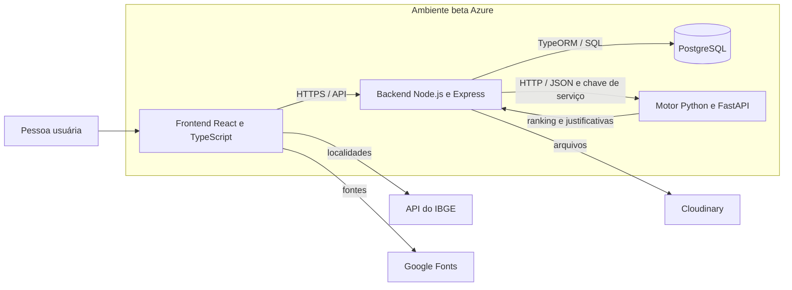

# Arquitetura do Juntaí!

Os perfis e as interações são persistidos pelo backend no PostgreSQL. Nas
recomendações, a API seleciona dados necessários e envia uma projeção ao motor;
a lista resultante retorna à interface pela API. No beta, o método configurado
é o de regras. O serviço semântico e o supervisionado são caminhos distintos;
o supervisionado é experimental e depende de artefatos e configuração.

Os dados cadastrais, mensagens e reuniões são transacionais; exposições e
interações são comportamentais. Consultas e recomendações acontecem sob demanda;
a conclusão de reuniões é verificada periodicamente pelo backend. O serviço
utiliza dados para apoiar conexões; a pontuação não é garantia de investimento.

